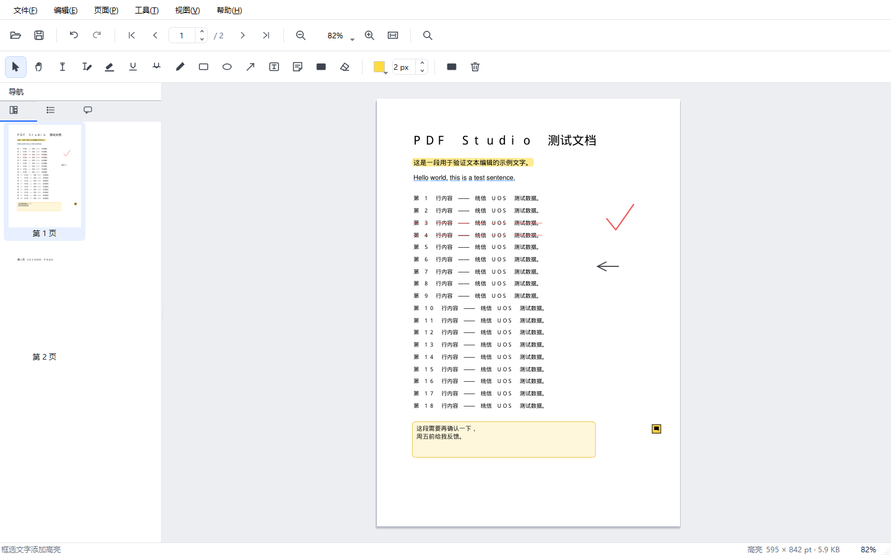
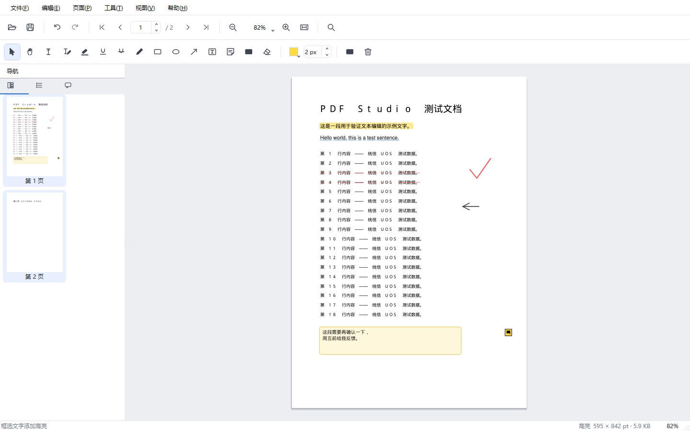
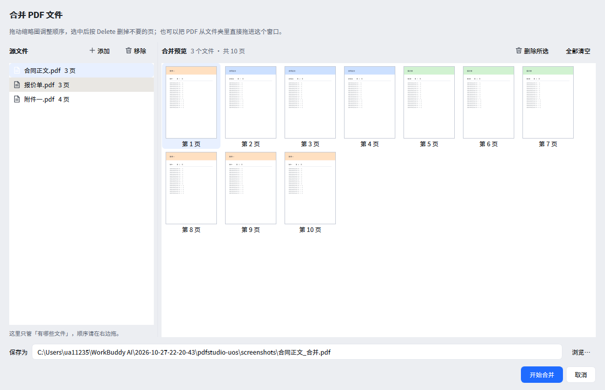
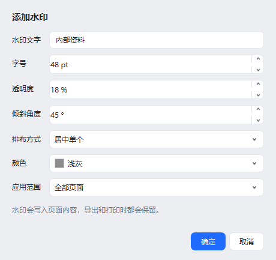

# PDF Studio · PDF 工作台

面向 **统信 UOS / 深度 Deepin / 麒麟** 等国产 Linux 桌面，以及 **Windows** 的
轻量 PDF 编辑器。  
纯 Python 实现（PyMuPDF + Qt），体积小、启动快、不依赖任何商业组件，  
装完就能读、能批注、能改字、能整页操作、能把多份 PDF 拼成一份。

> 📦 **第一次装、不熟悉 Linux？** 看 [安装说明.md](安装说明.md)，
> 照着做就行，不用懂命令行的原理。
> 本文件下面的内容偏开发与排错，给维护者看的。



---

## 功能

### 阅读

- 单页连续阅读，Ctrl + 滚轮缩放，缩放比例 10%–800%
- 适应宽度 / 整页显示（窗口变化时自动保持）
- 左侧缩略图导航，渲染分批进行，几百页的文档也不卡
- 文档目录（书签）、注释列表一览
- 全文查找，支持中文文字层被拆成「统 信 U O S」的容错匹配
- 加密文档自动弹出密码框

### 批注与标注

| 工具             | 说明                      |
| -------------- | ----------------------- |
| 高亮 / 下划线 / 删除线 | 框选文字即可，自动贴合文字行          |
| 画笔             | 自由手绘，可调粗细与颜色            |
| 矩形 / 椭圆 / 箭头   | 拖拽绘制，可改颜色线宽             |
| 文本框            | 插入带底色的便签式文字框，自动换行、自动缩字号 |
| 便签             | 添加批注图标，点开可看内容           |
| 擦除             | 点一下删除对应注释               |

选中注释后可拖动位置，按 `Delete` 删除；颜色与线宽在工具栏上直接切换。

### 改字（编辑正文）

点「改字」工具，再点页面上的任意一行文字，即可像 Word 一样改写内容。  
实现方式是先精确擦除目标区域的文字层（保留图片与矢量图形），再按原字号、  
原颜色写入新文字，所以周围排版不会被破坏。

> 扫描件没有文字层，需要先做 OCR（见下方「OCR」）。

### 页面操作

- **在左侧缩略图上按住拖动，直接调整页序**（拖动时会出现一条蓝色竖线标出落点，
  松手即生效，可 `Ctrl+Z` 撤销）
- **在空白处按住拖动 = 框选多页**（拖出半透明蓝框，框到的页自动选中，
  再配合右键菜单批量删除 / 旋转 / 提取）。两种手势互不干扰：
  按在缩略图上只排序、不框选；按在空白处只框选、绝不动页序
- 插入空白页（当前页之前 / 之后）
- 从其他 PDF 插入指定页码范围
- 删除页面（支持一次删多页）
- 旋转 90° / 180° / 270°（支持批量）
- 上移 / 下移 / 移到开头 / 移到末尾（不习惯拖拽时用）
- 提取选中页面为单独文件
- 拆分（每页一个文件 / 按页码范围）
- 合并到当前文档（把其他 PDF 追加进来）
- **合并多个 PDF 成一个新文件**（缩略图拖拽排序，见下）

**在左侧缩略图里按住 Ctrl / Shift 多选，然后右键**，即可对选中的多页批量操作：




### 合并多个 PDF

`文件 → 合并 PDF 文件…`（`Ctrl+M`），把几份 PDF 拼成一个文件。



- **缩略图就是最终顺序**，直接拖着改；跨文件拖也行，可以把 A 的第 5 页拖到 B 的第 2 页前面。
  拖动时格子上会出现一条蓝色竖线，标出松手后会插到哪一格
- 拖回原来的位置时，标题栏会提示「顺序没有变化」，不会让你误以为拖拽没生效
- 选中后按 `Delete` 删掉不要的页，`Ctrl` / `Shift` 可以一次选多页
- 从文件夹里把 PDF **直接拖进窗口**即可添加
- 添加多个文件时按文件名自然排序：`第2章` 排在 `第10章` 前面，不是字典序
- 加密的 PDF 会提示输入密码
- 左边只管「有哪些文件」，右边的顺序才是最终结果，两边不会打架

整个过程**不改动源文件**：页序只是一张表，反复拖拽调整不会累积质量损失，
最后一次性写出。合并 300 页大约 2 秒。

### 文档处理

- **水印**：支持倾斜角度、透明度、居中或整页平铺，写入页面内容（打印、导出都在）
- **页码**：六种位置，支持 `第 {page} 页 / 共 {total} 页` 这样的自定义格式
- **加密 / 解密**：AES-256，可分别控制打印、复制、修改、批注权限
- **涂黑脱敏**：按文字内容或正则表达式永久删除敏感信息（不是盖个黑框）
- **表单填写**：自动识别可填写字段并批量填入
- **压缩**：标准模式无损清理，强力模式重压图片（扫描件效果最好）
- **导出**：图片（PNG / JPEG）、纯文本、多页拼接长图
- **打印**：走系统 CUPS，按纸张自适应缩放
- **OCR**：识别扫描件文字（需系统安装 tesseract）



### 其他

- 完整撤销 / 重做（整份文档快照，最多 30 步）
- 保存时先写临时文件再原子替换，断电也不会写坏原文件
- 拖拽 PDF 到窗口即可打开
- 全矢量图标，不依赖系统图标主题，各种发行版下外观一致

---

## 安装

### 方式一：一键脚本（推荐）

```bash
tar -xzf pdfstudio-1.0.0.tar.gz      # 解压发行包
cd pdfstudio-1.0.0                   # 进解压出来的目录

# 安装到系统（需要 root，所有用户可用）
sudo ./packaging/install.sh

# 或者只装给当前用户（不需要 root）
./packaging/install.sh --user
```

> 手上直接就是源码文件夹（`pdfstudio-uos/`）的话，前两行不用管，
>   
> `cd` 进那个目录照做即可。
>   
> 还没有 tar 包就先跑一次 `python3 packaging/make_release.py --with-wheels` 生成
> （Windows 开发机上也能跑，不依赖 bash）。

脚本会自动做这几件事：

1. 探测机器上所有 Python 解释器，挑出已经装齐依赖的那个；
2. 如果都不完整，自动用 `apt` 或 `pip` 补齐，必要时建独立虚拟环境兜底；
3. 把最终选定的解释器**绝对路径**写进启动器，避免运行时用错 Python。

装完后在启动器里搜索「**PDF 工作台**」，或在终端执行 `pdfstudio`。

卸载：

```bash
sudo ./packaging/install.sh --remove
./packaging/install.sh --user --remove      # 当初用 --user 装的
```

### 启动不了怎么办

先跑诊断，它只读、不改动任何文件：

```bash
./packaging/install.sh --doctor
```

它会列出每个 Python 解释器的版本、PyMuPDF 版本、Qt 类型，并给出结论。
  
如果自动探测挑错了解释器，可以强制指定：

```bash
sudo PDFSTUDIO_PYTHON=/usr/bin/python3.7 ./packaging/install.sh
```

其他选项：`-y` 自动确认、`--no-deps` 只检查不安装、`-h` 查看帮助。

### UOS 上装不上依赖怎么办（重点）

UOS 的软件源是**封闭**的：`/etc/apt/sources.list` 指向
`professional-packages.chinauos.com`，必须系统已激活才能拉包，很多机器上
`apt install python3-pyqt5` 会直接失败。这不是脚本的问题，也不是你的操作问题。

安装脚本会自动绕开 apt，按下面的顺序找路：

1. **本地 wheel 目录**（`packaging/wheels/`）—— 有就离线装，完全不碰 apt 和网络；
2. **apt** —— 源能用就最快，不能用就跳过；
3. **pip + 国内镜像**（默认清华）—— UOS 上真正的主力方案；
4. **独立 venv** —— 系统 Python 被锁住时兜底。

三条路都不通（比如完全内网、没网），就用离线包：

```bash
# ① 在任意一台有网的电脑上（Windows / macOS / Linux 都行）
./packaging/fetch_wheels.sh --py 37     # UOS 20 自带 Python 3.7
# 产物：packaging/wheels/ ，约 85MB

# ② 把整个项目（含 wheels 目录）拷到 UOS

# ③ 在 UOS 上正常安装，脚本会自动发现 wheels 并离线装
sudo ./packaging/install.sh
```

`--py` 按 UOS 上的 Python 版本填：`37` / `38` / `39` / `310`，多个版本写
`--py 37,38`，或者 `--py all`。不确定就跑 `./packaging/install.sh --doctor` 看。

还可以直接打一个带依赖的发行包，拷过去解压即可装，全程不需要网络：

```bash
./packaging/fetch_wheels.sh --py 37
python3 packaging/make_release.py --with-wheels
```

`make_release.py` 在 Windows / macOS / Linux 上都能直接跑（`make_release.sh` 只是它的
转发壳，给习惯 `./xxx.sh` 的人用）。打完会**自动核对包内容**：必需的模块缺一个、
或者 PyInstaller 的 `dist*/` 构建残留混了进去，都直接返回非 0。
这一步是必须的——包比源码旧过一次，交出去的 79MB 包里连「合并 PDF」都没有，
而源码目录里测试全绿，谁都看不出来。

> 顺带两个 UOS 上的坑：
> - 没开**开发者模式**时 sudo 装包会被安全策略拦，路径是「控制中心 → 通用 → 开发者模式」；
> - 桌面启动报 `Could not load the Qt platform plugin "xcb"`，是缺
>   `libxcb-xinerama0`、`libxcb-cursor0`，同样受 apt 源限制，能联网时用 pip 装
>   PyQt5 一般会自带可用的 Qt 运行库。

### 方式二：deb 包

```bash
./packaging/build_deb.sh                 # 生成 build/pdfstudio_1.0.0_all.deb
sudo dpkg -i build/pdfstudio_1.0.0_all.deb
sudo apt -f install                      # 若提示缺少依赖
```

### 方式三：直接运行（不安装）

```bash
sudo apt install python3-pyqt5 python3-pymupdf    # UOS / Debian 系（老系统用 python3-fitz）
python3 run.py
python3 run.py 某个文档.pdf
```

直接运行时如果缺依赖，程序会打印当前解释器路径和可直接复制的修复命令，
  
而不是抛一串 `ImportError`。

### 方式四：Windows（免安装 Python）

Windows 上不需要用户装 Python，直接发一个压缩包：

```bash
# 在有开发环境的 Windows 上打包（一次性）
python -m PyInstaller packaging/windows/pdfstudio.spec --noconfirm \
    --distpath packaging/windows/dist --workpath packaging/windows/build
python packaging/windows/make_zip.py
# → packaging/windows/build/PDF工作台-1.0.0-Windows.zip  （约 51 MB）
```

对方拿到 zip 后：**解压 → 双击「安装.bat」**。安装到
`%LOCALAPPDATA%\Programs\PDFStudio`，不需要管理员权限，会建快捷方式、
关联 `.pdf`、在「应用和功能」里登记卸载入口。详见包里的 `使用说明.txt`。

打包要点（`pdfstudio.spec` 里都写了原因）：

- **单目录模式**，不是单文件。单文件每次启动都要解压到临时目录，慢好几秒
- **不开 UPX**，压缩过的 exe 极易被杀软误报
- 剔掉 `opengl32sw.dll`（20MB，纯控件程序不走 OpenGL）、PIL、多余语言包，
  体积从 160MB 降到 122MB
- `QtPrintSupport` 要显式加进 `hiddenimports`，否则打印会在用户机器上才崩

打包完可以自检，不需要人工点：

```bash
PDFStudio.exe --selftest 截图.png
# → SELFTEST OK ... 打印链路正常
```

它会真实建窗口、打开 PDF、截图，再用 `QPrinter` 输出一份 PDF 验证打印链路，
任何一环缺失都返回非 0。

安装/卸载脚本有端到端回归测试，会真的装一遍、覆盖装一遍、再卸一遍并查注册表：

```bash
python packaging/windows/_test_install.py
# → 通过 47 项，失败 0 项
```

这个测试存在的理由：`.bat` 用 LF 换行时 cmd 会按错误偏移解析
（`setlocal` → `etlocal`），重复安装会把 `.pdf` 关联备份覆盖成自己的 ProgId
导致卸载后变成悬空关联——两类问题都**只在本机能跑通的假象下潜伏**，
必须真装真卸才看得见。`make_zip.py` 打包前会自动调用
`_fix_scripts.py` 规范化编码换行，不依赖"记得手动跑"。

### 依赖说明

| 依赖                  | 说明               | 安装                                                                         |
| ------------------- | ---------------- | -------------------------------------------------------------------------- |
| Python ≥ 3.7        | UOS 20 自带 3.7，够用 | 系统自带                                                                       |
| PyMuPDF             | PDF 渲染与编辑内核      | `apt install python3-pymupdf`（老系统叫 `python3-fitz`）或 `pip3 install pymupdf` |
| PyQt5 **或** PySide6 | 界面框架，装哪个都行       | `apt install python3-pyqt5` 或 `pip3 install PySide6`                       |
| tesseract（可选）       | 仅 OCR 功能需要       | `apt install tesseract-ocr tesseract-ocr-chi-sim`                          |

程序会自动探测 PySide6 / PyQt5，两者都能跑；UOS 软件源里是 PyQt5，优先用它。

> Python 3.7 / 3.8 装不上新版 PyMuPDF，安装脚本会自动锁到 `pymupdf<=1.22.5`
>   
> 和 `pymupdf<=1.23.26`；手动装的时候也要注意这一点。

---

## 快捷键

| 快捷键                       | 功能          | 快捷键                 | 功能      |
| ------------------------- | ----------- | ------------------- | ------- |
| `Ctrl+O`                  | 打开          | `Ctrl+S`            | 保存      |
| `Ctrl+Shift+S`            | 另存为         | `Ctrl+P`            | 打印      |
| `Ctrl+M`                  | 合并 PDF 文件   | `F9`                | 显示/隐藏侧栏 |
| `Ctrl+Z` / `Ctrl+Shift+Z` | 撤销 / 重做     | `Ctrl+F`            | 查找      |
| `Ctrl+0`                  | 实际大小        | `Ctrl+1`            | 适应宽度    |
| `Ctrl+2`                  | 整页显示        | `Ctrl+=` / `Ctrl+-` | 放大 / 缩小 |
| `PageUp` / `PageDown`     | 上一页 / 下一页   | `Delete`            | 删除选中注释  |
| `Ctrl+Shift+L` / `R`      | 左旋 / 右旋 90° | `Ctrl+Shift+Delete` | 删除当前页   |
| `Ctrl+C`                  | 复制框选文字      | `Esc`               | 取消当前操作  |

工具快捷键：`V` 选择、`H` 抓手、`T` 选文字、`E` 改字、`G` 高亮、`U` 下划线、  
`D` 删除线、`P` 画笔、`R` 矩形、`O` 椭圆、`A` 箭头、`F` 文本框、`N` 便签、  
`X` 擦除、`B` 涂黑。

---

## 使用要点

**改字为什么没反应？**  
「改字」只能改**有文字层**的 PDF。如果点上去提示「这里没有可编辑的文字」，  
说明这是扫描件（整页就是一张图），请先用「工具 → OCR 识别当前页」看看能否识别。

**文本框和便签有什么区别？**  
文本框写入页面内容（跟正文一样，任何阅读器都能看到，导出打印都在）；  
便签是 PDF 注释，阅读器里显示为一个小图标，点开看内容。要留「修改意见」用便签，  
要往页面上写字用文本框。

**涂黑能恢复吗？**  
不能。涂黑会真正删除底层的文字和图形，无法通过复制或还原恢复。  
操作前建议先「另存为」一份备份，或者用撤销（`Ctrl+Z`）在保存前撤回。

**保存会覆盖原文件吗？**  
`Ctrl+S` 会覆盖当前文件，但采用「写临时文件 → 原子替换」的方式，  
中途失败不会把原文件写坏。想保留原件请用「另存为」。

---

## 项目结构

```
pdfstudio-uos/
├── run.py                  启动入口（不安装也能直接跑）
├── pdfstudio/
│   ├── app.py              QApplication 初始化、主题、命令行参数
│   ├── qtcompat.py         PyQt5 / PySide6 兼容层
│   ├── core/               与界面完全解耦的 PDF 内核（可单独测试）
│   │   ├── document.py     文档模型、渲染缓存、撤销栈、搜索
│   │   ├── pageops.py      插入 / 删除 / 旋转 / 移动 / 拆分 / 追加合并
│   │   ├── merge.py        多文件合并：源文件管理 + 任意页序输出
│   │   ├── annotate.py     高亮、手绘、图形、文本框、便签
│   │   ├── textops.py      改字（redact + 重写）、插入文字、OCR
│   │   ├── security.py     加密、解密、涂黑脱敏
│   │   ├── decorate.py     水印、页码、页眉页脚、卷宗编号
│   │   └── export.py       压缩、导出图片 / 文本 / 长图
│   └── ui/
│       ├── main_window.py  菜单、工具栏、状态栏、业务编排
│       ├── page_view.py    画布：渲染、缩放、鼠标交互、绘制预览
│       ├── side_panel.py   缩略图 / 目录 / 注释列表
│       ├── welcome.py      欢迎页
│       ├── dialogs.py      各类对话框
│       ├── merge_dialog.py 合并窗口：缩略图拖拽排序
│       ├── icons.py        QPainter 现场绘制的矢量图标
│       └── theme.py        浅色主题 QSS
├── packaging/
│   ├── install.sh          一键安装 / 卸载
│   ├── build_deb.sh        构建 deb 包
│   ├── make_release.py     打 UOS 源码发行包（自带包内容自检，全平台可跑）
│   ├── make_release.sh     上面那个的转发壳
│   ├── fetch_wheels.sh     下载 UOS 离线依赖 wheel
│   ├── wheels/             离线依赖（80MB，默认不进包，--with-wheels 才带）
│   ├── icons/              16–512 px 应用图标
│   └── windows/            Windows 打包（PyInstaller + 安装脚本）
│       ├── pdfstudio.spec  PyInstaller 配置
│       ├── install.ps1     安装：拷文件 / 快捷方式 / 关联 .pdf / 卸载入口
│       ├── uninstall.ps1   卸载：全部还原
│       ├── _fix_scripts.py 统一 .bat/.ps1 的编码与换行（打包前自动跑）
│       ├── make_zip.py     打成分发包
│       ├── _test_install.py 解压→装→覆盖装→运行→卸 的端到端测试（47 项）
│       └── 使用说明.txt     给最终用户的说明
└── tests/
    ├── smoke_core.py       内核自测（39 项，不需要图形界面）
    ├── ui_smoke.py         界面自测（28 项，含真实鼠标拖拽 / 框选与截图）
    ├── _thumb_probe.py     缩略图校验工具（比对缩略图画的是不是对的那页）
    ├── _audit_thumbs.py    缩略图专项审计（25 个场景，开发时手动跑）
    └── shots.py            生成文档截图
```

### 设计上的几个取舍

- **内核与界面解耦**：`core/` 里没有一行 Qt 代码，可以脱离图形环境跑测试，  
  也方便以后换 GUI 框架或做命令行工具。
- **撤销用整份快照**：PDF 的对象结构改动很难做增量撤销，直接存整份字节流  
  最可靠。上限 30 步 / 480 MB，超出自动丢最旧的。
- **文本框不用 FreeText 注释**：PyMuPDF 生成 FreeText 外观时会忽略填充色，  
  首尾字符还会被裁掉，所以改成直接绘制底色 + 写入文字，效果稳定可预期。
- **图标全部手绘**：避免在 UOS 上因为缺图标主题出现空白按钮。
- **合并只维护一张页序表**：`MergePlan.order` 里每一项是「哪个文件的第几页」，
  拖拽、删页都只改这张表，源文件一个字节不动。这样反复调整顺序不会累积
  质量损失，也不需要为合并单独做撤销栈；写文件时才一次性把连续页压成区间
  拷贝过去（300 页约 2 秒）。
- **拖拽完全不用 Qt 的 `QDrag`**：Qt 内置拖拽要进 `QDrag::exec()`，那是一个
  **平台级模态循环**——实测在本机上拖拽开始后松手没有任何响应，界面像卡住。
  更麻烦的是这个模态循环自动化测试进不去，测试只能覆盖它之外的代码，
  于是「改完测试全绿、用户还是拖不动」连着发生过两轮。
  现在按压 / 移动 / 松手全由 `MergePageList` 自己处理，超过
  `startDragDistance()` 才算拖拽，落点由 `_drop_target()` 算、搬行由
  `apply_drop()` 做。没有模态循环、没有平台差异，**测试能用真实鼠标事件把
  整条链路完整跑一遍**。

---

## 测试

```bash
# 内核测试：不需要图形界面，CI 里也能跑
python3 tests/smoke_core.py

# 界面测试：真实构建窗口、跑一遍主要交互，并输出截图
python3 tests/ui_smoke.py

# 缩略图专项审计：把插入/删除/旋转/换序/撤销等 25 个场景全跑一遍
python3 tests/_audit_thumbs.py
```

内核测试覆盖：打开/渲染/文本提取/搜索（含中文容错）/注释增删改/改字/  
水印/页码/撤销重做/旋转/移动/插入/提取/拆分/合并/加密解密/涂黑/  
压缩/导出/保存/元数据，以及多文件合并的页序、删页、移除源文件、
加密源、损坏文件、自然排序，最后一条是**发行包收集规则**——
核的是 `make_release.py` 真的会把所有源码打进去、且不会把
`packaging/windows/dist*/` 那上百 MB 构建残留混进包。
它防的不是代码 bug，而是"包比源码旧"这类事故：
交付出去的东西和本机测过的东西不是同一份，本机永远是绿的。

缩略图这类"看着不对"的问题，只查条目数和尺寸是查不出来的——  
异步渲染几毫秒后就会把尺寸恢复正常，而画错页、停在灰色占位图上  
都不会改变条目数。所以 `_thumb_probe.py` 会把缩略图缩成 4×4 的  
颜色指纹，和按同样参数直接渲染出来的页面逐格比对。

---

## 常见问题

**安装脚本提示「缺少运行依赖：pymupdf」**  
最典型的原因是依赖装在了另一个 Python 里：`pip3 install pymupdf` 装进了
  
`python3.10` 的用户目录，而 `python3` 实际是 3.7；或者你用普通用户
  
`pip install --user` 装好后又 `sudo ./install.sh`，root 的 `HOME` 是 `/root`，
  
看不到你的用户目录。

现在的脚本会自动扫全部解释器、必要时自己装依赖，通常重跑一次就好：

```bash
sudo ./packaging/install.sh
./packaging/install.sh --doctor      # 还不行就看看它列出的每个解释器状态
```

**启动时报 `ModuleNotFoundError: No module named 'fitz'`**  
缺 PyMuPDF：`sudo apt install python3-pymupdf`（老系统 `python3-fitz`）
  
或 `pip3 install pymupdf`。Python 3.7/3.8 要用 `pip3 install 'pymupdf<=1.22.5'`。

**报 `Could not load the Qt platform plugin "xcb"`**  
缺 Qt 的 xcb 运行库：`sudo apt install libxcb-xinerama0 libxcb-cursor0`。  
Wayland 会话下如果仍异常，可临时用 `QT_QPA_PLATFORM=xcb pdfstudio` 启动。

**界面中文显示成方框**  
缺中文字体：`sudo apt install fonts-noto-cjk`。

**OCR 提示不可用**  
安装 tesseract 与中文包：`sudo apt install tesseract-ocr tesseract-ocr-chi-sim`。

**打开大文件很慢**  
首次打开会生成缩略图，属正常现象；缩略图是分批渲染的，不影响正文浏览。  
如果文件本身是几百 MB 的扫描件，建议先用「压缩 → 强力」瘦身。

**打印出来是空白**  
检查是否在打印对话框里选错了页码范围；程序默认打印全部页面。

---

## 许可

MIT License，见 [LICENSE](LICENSE)。

PDF 渲染与编辑能力来自 [PyMuPDF](https://pymupdf.readthedocs.io/)（AGPL / 商业双许可），  
若用于商业分发请留意其授权条款。
